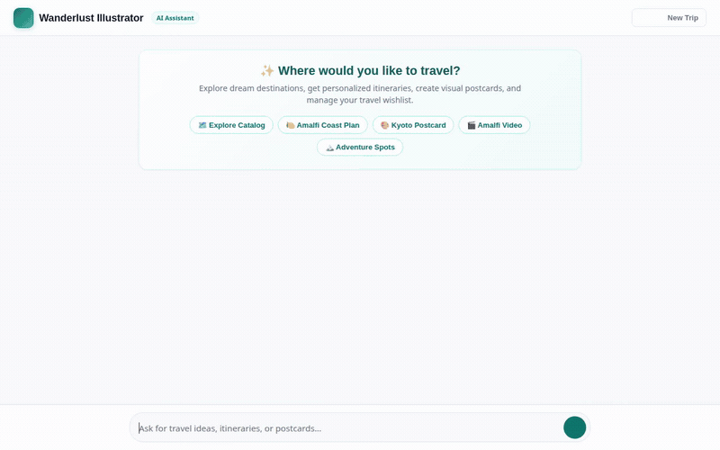

# 🌍 Wanderlust Illustrator — Agentic Travel Planner & Postcard Studio

<div align="center">



### An agent-first AI travel planner that curates custom dream itineraries, remembers traveler preferences and wishlists across sessions, queries live weather, runs budget computations in a secure code sandbox, and generates vibrant visual travel postcards and teaser videos.

[](https://wanderlust-illustrator-frontend-494495082021.us-east1.run.app)

> 🚀 **Live Demo**: [https://wanderlust-illustrator-frontend-494495082021.us-east1.run.app](https://wanderlust-illustrator-frontend-494495082021.us-east1.run.app)  
> *(Note: Deployed on Google Cloud Run during the Build with Gemini workshop).*

</div>

---

## 🌟 What This Agent Does

**Wanderlust Illustrator** is an autonomous travel planning agent built with Google's **Agent Development Kit (ADK)** and `agents-cli`. It interacts conversationally with travelers to explore curated destinations, manage bucket lists, fetch real-time weather forecasts, calculate travel budgets, and create AI-illustrated postcards and cinematic destination clips.

### Implemented Capabilities & Real Cloud Wiring

| Feature / Service | How It Is Implemented | Code Location |
|---|---|---|
| 🧠 **Cross-Session Memory** | **Vertex AI Memory Bank** (`PreloadMemoryTool` + `generate_memories_callback`). Proactively extracts and persists traveler travel styles, preferred vibes, budget tiers, and bucket list wishlists across distinct sessions. | [`app/agent.py`](app/agent.py) |
| 🗄️ **Destination Catalog** | **Cloud Firestore** collection (`destinations`). Powers `list_destinations`, `get_destination`, and `add_or_update_destination` with filtering by travel vibe and budget tier. | [`app/agent.py`](app/agent.py), [`seed_firestore.py`](seed_firestore.py) |
| 🖼️ **Postcard Illustration** | **Gemini Image Generation** (`gemini-3.1-flash-lite-image`). Creates stylized travel postcards on demand via `generate_destination_postcard`. | [`app/agent.py`](app/agent.py) |
| 🎬 **Cinematic Video Generation** | **Gemini Omni** (`gemini-omni-flash-preview`). Generates short cinematic destination teaser videos via `generate_destination_video`. | [`app/agent.py`](app/agent.py) |
| ☁️ **Media & Artifact Storage** | **Google Cloud Storage** (`wanderlust-gallery-*` bucket). Uploads generated images/videos directly and returns public HTTPS URLs while saving artifacts to the ADK session via `tool_context.save_artifact`. | [`app/agent.py`](app/agent.py) |
| 🌤️ **Live Weather & Forecasts** | **Open-Meteo Geocoding & Forecast API**. Provides real-time temperatures, apparent temperatures, humidity, wind speeds, and daily highs/lows for any global destination via `get_destination_live_weather`. | [`app/agent.py`](app/agent.py) |
| 🧪 **Secure Code Sandbox** | **Agent Engine Sandbox Code Executor** (`AgentEngineSandboxCodeExecutor`). Safely executes Python code for budget allocations, currency conversions, and itinerary day splits. | [`app/agent.py`](app/agent.py) |
| 🪟 **Agent-First Rich UI** | **A2UI v0.8 Basic Catalog** with custom after-model callback (`a2ui_callback`). Emits structured JSON rendering cards, rows, columns, and public image previews. | [`app/agent.py`](app/agent.py), [`app/a2ui_utils.py`](app/a2ui_utils.py) |
| 🌐 **Modern Chat Frontend** | **FastAPI A2A Proxy** + responsive Web UI with welcome prompt chips, A2UI renderer, and lightbox image viewer/downloader. | [`frontend/`](frontend/) |

> **Planned / Stretch Goals (Not Yet Implemented):**
> - Live Google Maps / Places API venue booking integration.
> - Multi-day route optimization graph solver.

---

## 🛠️ Architecture & Tech Stack

```
   ┌────────────────────────────────────────────────────────┐
   │             Responsive Web Chat Frontend               │
   │  (Welcome Chips, Live Messages, A2UI Cards, Lightbox)  │
   └───────────────────────────┬────────────────────────────┘
                               │ HTTP / JSON
                               ▼
   ┌────────────────────────────────────────────────────────┐
   │             FastAPI A2A Protocol Proxy                 │
   │           (Google ADC Auth Passthrough)                │
   └───────────────────────────┬────────────────────────────┘
                               │ A2A Protocol
                               ▼
   ┌────────────────────────────────────────────────────────┐
   │      ADK Root Agent (Gemini 2.5 Flash on Vertex AI)     │
   ├───────────────────────────┬────────────────────────────┤
   │ 🧠 Vertex AI Memory Bank  │ 🗄️ Cloud Firestore DB      │
   │ 🖼️ Gemini Image Gen       │ 🎬 Gemini Omni Video Gen   │
   │ ☁️ Cloud Storage (Media)  │ 🌤️ Open-Meteo Weather Tool │
   │ 🧪 Agent Engine Sandbox   │ 🪟 A2UI v0.8 Output Layer  │
   └───────────────────────────┴────────────────────────────┘
```

---

## 📂 Project Structure

```
.
├── agents-cli-manifest.yaml         # Agent Engine deployment manifest
├── pyproject.toml                   # Project dependencies
├── seed_firestore.py                # Initializer script for destination catalog
├── app/                             # Agent definition
│   ├── __init__.py
│   ├── a2ui_utils.py                # A2UI stream parser & callback
│   └── agent.py                     # Root agent, tools, and callbacks
└── frontend/                        # Web chat interface
    ├── Dockerfile                   # Cloud Run container definition
    ├── main.py                      # FastAPI A2A proxy server
    ├── requirements.txt             # Proxy dependencies
    └── static/
        └── index.html               # Responsive chat UI with A2UI & Lightbox
```

---

## 🚀 Running Locally

### 1. Prerequisites

- Python 3.11+
- [uv](https://docs.astral.sh/uv/) or standard Python `pip` & `venv`
- Google Cloud SDK (`gcloud`) authenticated:
  ```bash
  gcloud auth login
  gcloud auth application-default login
  gcloud config set project <YOUR_GCP_PROJECT_ID>
  ```

---

### 2. Run the Agent in Development Playground

To test the agent with live reload using the ADK Dev Playground:

```bash
# Install agent dependencies
uv sync

# Launch ADK Web Playground
uv run agents-cli playground
```

---

### 3. Seed Destination Catalog (Optional)

If your Firestore database does not yet have destinations populated:

```bash
uv run python seed_firestore.py
```

---

### 4. Run the Full Chat Frontend

To run the custom chat web UI locally connecting to your deployed Agent Runtime:

```bash
cd frontend

# Create and activate virtual environment
python3 -m venv .venv
source .venv/bin/activate

# Install frontend dependencies
pip install -r requirements.txt

# Set your Agent Engine Resource Name and Agent Directory
export AGENT_ENGINE_RESOURCE_NAME="projects/<PROJECT_NUMBER>/locations/us-east1/reasoningEngines/<ENGINE_ID>"
export AGENT_DIRECTORY="app"

# Start the FastAPI proxy server
python main.py
```

Open your browser to port `8080` on localhost.

---

## ☁️ Deployment

### Deploy Agent to Agent Runtime

Deploy the reasoning engine using `agents-cli`:

```bash
agents-cli deploy
```

### Deploy Frontend to Cloud Run

Build and deploy the containerized FastAPI proxy to Google Cloud Run:

```bash
cd frontend

gcloud builds submit --tag gcr.io/<YOUR_GCP_PROJECT_ID>/wanderlust-frontend

gcloud run deploy wanderlust-frontend \
  --image gcr.io/<YOUR_GCP_PROJECT_ID>/wanderlust-frontend \
  --platform managed \
  --region us-east1 \
  --allow-unauthenticated \
  --set-env-vars AGENT_ENGINE_RESOURCE_NAME="<YOUR_AGENT_RESOURCE_NAME>",AGENT_DIRECTORY="app"
```

---

## 📄 License

This project was built during the **Build with Gemini World Tour** using Google Cloud Agent Development Kit (ADK) and Vertex AI Agent Platform.
